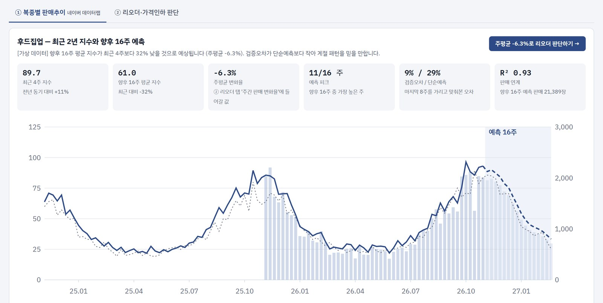
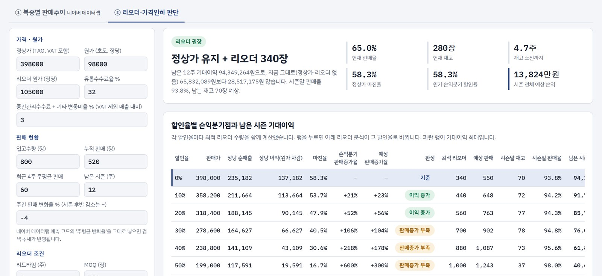
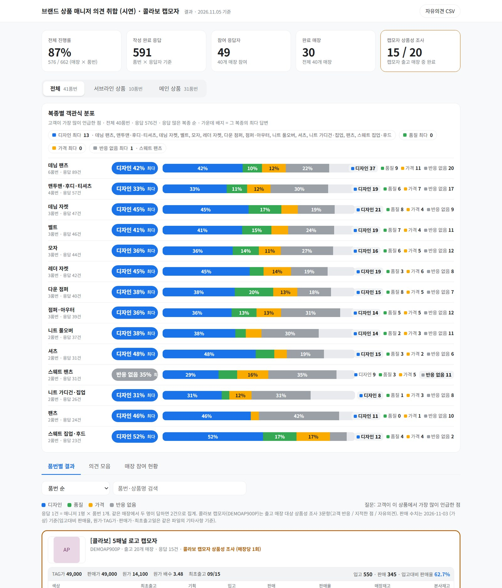
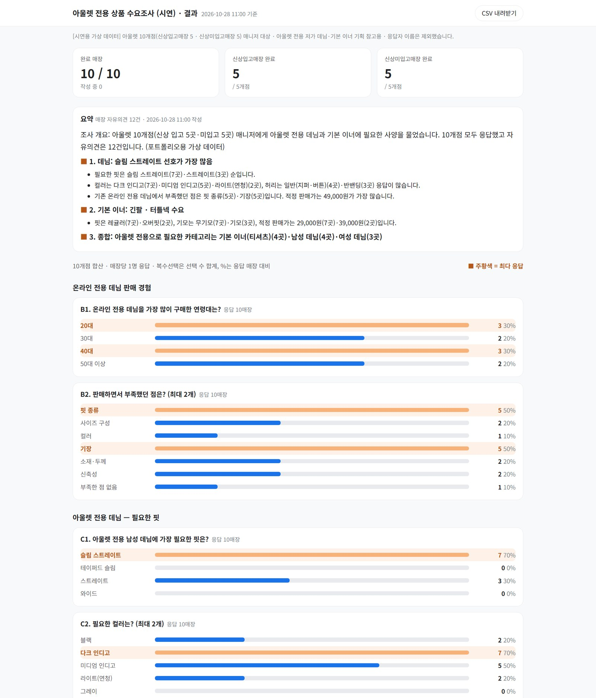

# 기획MD 업무 도구 포트폴리오

패션 브랜드 MD로 일하며 반복되는 판단과 수작업을 줄이기 위해 직접 만든 도구들입니다.
AI 코딩 도구(Claude Code)를 활용해 기획부터 데이터 처리, 화면까지 혼자 설계하고 만들었습니다.

> **모든 화면과 데이터는 포트폴리오용 예시(가상) 데이터입니다.** 실제 매장명·품번·판매·원가·고객 의견은 포함되어 있지 않습니다.

## 데모 바로 보기

| 프로젝트 | 데모 | 한 줄 설명 |
|---|---|---|
| 판매추이 예측 · 리오더 판단 보드 | [열기](https://hkyeng0911-png.github.io/md-portfolio/sales-trend-reorder/) | 네이버 데이터랩 지수로 복종별 추세를 예측하고, 리오더 수량과 할인율별 손익분기점을 계산 |
| 시즌 상품 매니저 의견 취합 결과 페이지 | [열기](https://hkyeng0911-png.github.io/md-portfolio/survey-result-demo/public/) | 전국 매장 매니저의 신상품 반응을 모아 품번별·복종별·매장등급별로 보여주는 공유 페이지 |
| 아울렛 전용 상품 수요조사 결과 페이지 | [열기](https://hkyeng0911-png.github.io/md-portfolio/outlet-survey-demo/public/) | 아울렛 매장 매니저에게 전용 데님·기본 이너에 필요한 사양을 묻고, 문항별 분포와 요약을 보여주는 페이지 |

---

## 1. 판매추이 예측 · 리오더 판단 보드




**왜 만들었나** — 리오더와 가격인하를 판매율과 경험에 기대어 정하다 보니, 남은 시즌 수요 흐름과 할인율별 손익을 한 번에 비교하기 어려웠습니다.

**무엇을 하나**
- **① 복종별 판매추이** — 네이버 데이터랩 주간 지수로 복종별 향후 4~26주 추세를 예측합니다. 1~2년 전 같은 주의 패턴에 최근 8주 성장률을 곱하는 방식이고, 마지막 8주를 가리고 맞춰본 검증오차를 '최근 4주 평균 유지' 예측과 비교해 믿을 만한지 함께 보여줍니다. 주차별 판매수량을 올리면 지수와의 관계(R²)로 판매량까지 추정합니다.
- **날씨 비교** — 지역별(서울·대전·대구·광주·부산) 주평균 기온을 전년 같은 주와 비교하고, 주평균이 처음 10°C 아래로 내려간 시점(아우터 시즌 시작 신호)을 금년·전년으로 보여줍니다. Open-Meteo 기상 재분석·예보를 페이지에서 바로 불러옵니다.
- **② 리오더 · 가격인하 판단** — 할인율 0~50%마다 손익분기 판매증가율과 남은 시즌 기대이익을 계산하고, 리드타임·MOQ를 반영해 기대이익이 가장 큰 리오더 수량을 찾습니다. 여러 품번을 엑셀에서 붙여넣어 한 번에 판단할 수도 있습니다.
- **연결** — ①에서 나온 주평균 변화율을 버튼 하나로 ②의 수요 가정에 넣습니다.

**계산 방식 (요약)**
- 주차별 수요 = 최근 주평균 판매 × (1 + 주간 변화율)^주차 × (1 − 할인율)^−탄력성
- 수요를 정규분포로 보고 재고 한도 안에서 기대판매량을 계산 → 품절 손실과 재고 처분 손실이 균형을 이루는 수량을 MOQ·10장 단위로 탐색

**파일**
- [`sales-trend-reorder/index.html`](sales-trend-reorder/index.html) — 보드 (HTML 파일 하나, 설치 없이 브라우저에서 실행)
- [`sales-trend-reorder/naver_datalab_forecast_colab.py`](sales-trend-reorder/naver_datalab_forecast_colab.py) — 네이버 데이터랩 수집·예측 Colab 코드. 결과 엑셀을 보드 ① 탭에 올리면 실제 지수로 바뀝니다. (API 키는 코드에 넣지 않고 실행할 때 입력)

## 2. 시즌 상품 매니저 의견 취합 결과 페이지



**왜 만들었나** — 신상품 반응을 ERP 게시글로 받다 보니 참여도가 낮고, 입고되지 않은 상품까지 전 매장이 확인해야 하는 번거로움이 있었습니다.

**무엇을 하나**
- 매장별로 실제 출고된 상품만 설문 문항으로 만들어 모바일로 받고, 응답을 품번별 · 복종별 · 매장등급별로 모아 보여줍니다.
- 자유의견을 규칙 기반으로 '디자인 / 디자인 외(가격·날씨·물량 등) / 제외'로 자동 분류하고, 판매율·판매 상위 매장과 함께 봅니다.
- 관리자 키 없이 열리는 정적 페이지로 만들어 타부서와 공유하고, 자유의견을 CSV로 내려받을 수 있습니다.

**파일** (이 저장소에는 결과 페이지 부분만, 가상 데이터로 담았습니다)
- `make_demo_data.py` — 가상 매장 40곳·품번 41개·응답 데이터 생성
- `classify.py` — 자유의견 분류 규칙
- `build.py` + `template.html` — 데이터를 내장한 결과 페이지(`public/index.html`) 생성

```bash
cd survey-result-demo
python make_demo_data.py
python build.py
```

## 3. 아울렛 전용 상품 수요조사 결과 페이지



**왜 만들었나** — 아울렛 전용 저가 데님과 기본 이너를 기획하기 전에, 실제로 아울렛에서 어떤 핏·컬러·가격대가 팔리는지 매장 의견을 빠르게 모아야 했습니다.

**무엇을 하나**
- 대상 매장 매니저가 모바일로 답하는 설문(단일·복수 선택, 조건부 문항, 자유의견)을 만들고, 결과를 문항별 분포로 보여줍니다.
- 매장 그룹(신상 입고 / 미입고)별 진행 현황, 문항별 최다 응답 강조, 자유의견 모음, CSV 내려받기를 제공합니다.
- 응답과 자유의견을 묶어 기획 회의용 요약을 맨 위에 붙였습니다. (시연판의 요약은 가상 응답을 집계해 자동으로 만든 문장)

**파일**
- `make_demo.py` — 가상 매장 10곳·응답 생성 → `public/index.html`, `public/outlet_survey_result.csv`
- `template.html` — 결과 페이지 화면

---

## 사용 도구
Claude · Claude Code · Python(pandas, openpyxl) · Google Colab · HTML / Vanilla JS · SVG 차트 · SheetJS · 네이버 데이터랩 API · GitHub Pages
